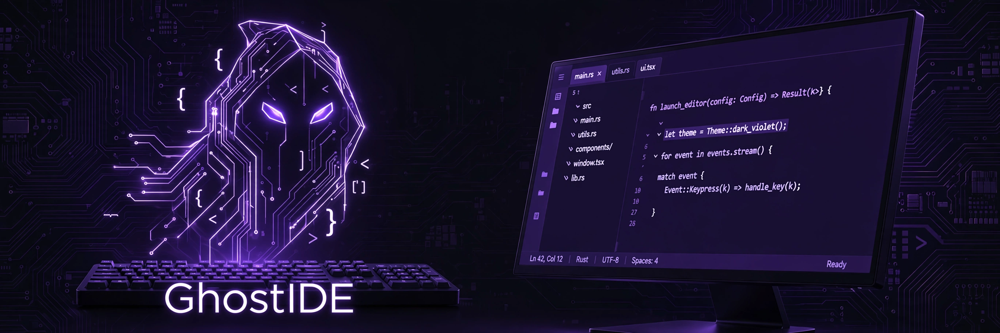

# GhostIDE 👻

A fully offline AI code editor from Ghost Developer Studio.
The editor, the chat, the agent, and the autocomplete all
run locally: the AI is a Qwen2.5-Coder model served by
llama.cpp on the desktop, or running on-device in the
Android app (see the
[`ghostide-android`](https://github.com/littlestjames82-sys/ghostide-android)
repo). No cloud, no API key, no account.

**Your code never leaves the device. The AI lives here.**

**▶ Watch it run: [the 55-second demo](docs/media/ghostide-demo.mp4)** —
the real app, driven live: editor diagnostics on a real syntax
error, the git client, a live test run, the ecosystem catalog,
and the agent's approval controls. Narrated by Ryan.

This repo is the shared heart of both editions: the
frontend bundle built from `web/src` ships in the desktop
app *and* inside the Android APK, and `server.py` is the
reference implementation of the API the Android app's
Java server mirrors. One behavior pack (`BEHAVIOR.md`)
drives both, so the editions cannot silently drift.

## Download

Current version: **3.21.0** (desktop and Android move on one
train; Android versionCode 220).

- **Downloads site:** https://downloads.ghostdeveloperstudio.com/
  carries the desktop packages (Linux, macOS, Windows), the
  Android APK, and the update manifests both editions check.
  Every file there is SHA-256 listed on the page.
- **From this repo:** the
  [`downloads`](https://github.com/littlestjames82-sys/ghost-ide/tree/downloads)
  branch carries the same binaries with a SHA256SUMS file per
  version, and the
  [v3.20.0 release](https://github.com/littlestjames82-sys/ghost-ide/releases/tag/v3.20.0)
  notes describe the current feature set.
- **Android:** the APK also lives in the
  [`ghostide-android`](https://github.com/littlestjames82-sys/ghostide-android)
  repo (its `downloads` branch). It installs over any earlier
  build; the app checks for updates itself, at most once a day.

Recent additions: Git depth (stage individual hunks, a
three-pane merge conflict editor on desktop and a card-based
resolver on phones), a phone layout gate with a configurable
symbol row and 40px touch targets, the in-app APK update
check, and the Git phone pack: your GitHub token stored in
the Android Keystore (never readable back, never written to
a repo config or log), shallow clone by default, and
per-card conflict resolution. See `CHANGELOG.md` for the
3.11 to 3.21 run.

## The model store (Qwen2.5-Coder-Instruct, Q4_K_M GGUF)

| Model | Download | RAM while running | Notes |
|---|---|---|---|
| 0.5B Sprinter | 380 MB | ~0.7 GB | phone store; fastest, rough edges |
| 1.5B Balanced | 0.94 GB | ~1.5 GB | phone default |
| 3B Smarter | 1.93 GB | ~2.6 GB | phone store; 6 GB+ phones |
| 7B Max | 4.68 GB | ~5.5 GB | desktop default + phone store (8 GB+ phones) |

Every download is exact-size and SHA-256 verified before
use, and resumable. On the desktop, download the 7B in
Settings ("Download 7B model"), switch models any time
with a GGUF path in Settings or `GHOST_IDE_MODEL`, or use
the in-app model switcher.

The model store (Tools, or Settings, "Open the model
store", added in desktop 3.16.0) offers all four sizes as Q4_K_M
downloads (0.5B 0.46 GB, 1.5B 1.04 GB, 3B 1.96 GB, 7B
4.36 GB) plus the nomic embedding model, one card each
with an estimated RAM figure and a fit mark read from
this machine's actual RAM (guidance only, never a
block), download progress with pause (the partial file
is kept and resumed) and cancel, delete with a guard
for the loaded model, a disk usage line, and custom
GGUF import from a local file or a web address.
Imported models are labelled "Imported by you": the
GGUF header is checked and the SHA-256 recorded at
import, and the source is not verified by GhostIDE.

## Run it

From source (needs Python 3.11+ and a llama.cpp build):

```bash
./start.sh                 # http://127.0.0.1:5173
```

Then click **Start model** in the top bar (first load
takes about a minute).

As a packaged app (Roadmap G18): `packaging/` builds
installable packages for Linux, macOS, and Windows
(PyInstaller, one-command install, workspace seeded in
~/GhostIDE). A manual GitHub Actions workflow
(`.github/workflows/build-desktop.yml`) builds all
three. The package contains no model and no llama.cpp;
the 7B is an optional in-app download, and the pinned
llama.cpp runtime is fetched on first use, verified by
SHA-256 like the model.

Pair mode: another device can join this workspace with a
pairing token (tokens expire in 12 hours; viewers are
read-only). Binding the server beyond loopback
(`GHOST_IDE_HOST=0.0.0.0`) is for trusted networks: the
pairing gate protects the API, but the static shell is
served ungated by design.

## What's inside

- **Editor**: CodeMirror 6 (JS/TS, Python, HTML, CSS,
  JSON, Markdown), tabs, split view, multi-cursor,
  **live syntax diagnostics** in the gutter as you type,
  **code folding**, find & replace with regex, ignore-case
  and dry-run previews, command palette, quick open,
  local history with restore, autosave draft recovery,
  and session restore down to cursor positions.
- **Ghost Chat**: streaming chat with context modes:
  current file, smart slice (the file's dependency web,
  reason-tagged and budget-packed), or project slice
  (signatures or full) with a token meter.
- **Agent mode**: Ghost plans and executes multi-file
  changes one action at a time; writes stage for your
  review with diffs, and nothing lands until you
  approve it. The agent cannot declare DONE over broken
  staged code (staged files are syntax-checked first,
  with bounded self-repair rounds you control), it can
  pause mid-run, queue follow-ups, keep a scratchpad,
  dispatch read-only EXPLORE sub-runs, and works under
  step budgets — with a full replayable trail per run.
- **Git**: a complete daily client — status with
  ahead/behind, stage, commit, branches, stash, tags,
  amend, worktrees, blame, log with a commit viewer,
  remotes — behind server-side input pins (names
  regex-checked, refs rebuilt, hashes hex-pinned). The
  agent's git surface is read-only by construction.
- **Tests & verify**: discover and run Python + Node
  tests — whole suite, one file, or a single test by
  name — re-run only failures, and run the verify
  pipeline with evidence levels (Executed / Claimed /
  Gaps, never a silent pass).
- **The ecosystem**: 29 bundled Ghost tools (GhostSlice,
  GhostMCP, GhostApprove, GhostIndex, GhostReview, and
  24 more) execute for real against the workspace; the
  full table lives in the Android repo's README, and
  the bundle only builds when every tool's own tests
  pass (2,871 at generation e13).
- **Platform**: project templates, a sandboxed plugin
  system (`PLUGINS.md`), pair mode with conflict-safe
  sync, voice coding, and optional encrypted backups
  (`PRIVACY.md` explains the data story, which is
  short: nothing is collected).
- **Updates**: Settings can check for updates against
  `VERSION.json` in this repo (report-only). The
  packaged desktop app goes one step further, with the
  user's say-so at every step: it checks `latest.json`
  on the downloads site, downloads and SHA-256-verifies
  the package, stages it, and swaps it in on the next
  restart, keeping the previous version for one-click
  rollback. Nothing is ever installed silently, and
  source runs stay report-only.
- **Portable mode** (desktop): run with `--portable`
  (or `GHOSTIDE_PORTABLE=1`) and everything the app
  keeps - seeded workspace, models, the llama.cpp
  runtime, settings/state, trust decisions - lives in
  a `ghostide-data/` folder beside the executable (or
  beside `server.py` in a source run).
- **Workspace trust + AGENTS.md** (desktop): a folder
  opened in the IDE starts untrusted until you trust
  it; while untrusted, agent actions, terminal
  execution and MCP tools are refused by the server
  itself. An `AGENTS.md` at the workspace root (or a
  `.ghostide/AGENTS.md` override) is folded into the
  agent's system context, and Settings shows which
  instruction files are loaded.
- **Agent trust layer** (desktop, v3.13.0): a finished
  plan is also written to `.ghostide/plans/plan-<time>.md`
  in the workspace, where it can be opened and edited
  like any file - acting on the plan re-reads that
  file, so edits to it change what runs. Each agent
  run owns **one checkpoint** in
  `.ghostide/checkpoints/`: the pre-run content of
  every file the run touches, captured lazily on
  first touch (files over 512 KB or binary are
  skipped and named in the review, never silently).
  After an apply, a **run review** lists what the
  run changed - modified, created, deleted - with
  per-file **Keep** (accept, drop the undo point) and
  **Undo** (restore the pre-run content; created
  files are removed, deleted files come back), an
  Undo All, and per-hunk undo in the diff view (a
  hunk whose text no longer matches the file is
  refused, not guessed). Every run, plan or act,
  leaves a **run record** in `.ghostide/agent-runs/`
  (prompt, plan file, steps, approvals, files
  changed, checkpoint, outcome), readable over
  `GET /api/agent-runs`.
- **Language servers / LSP** (desktop, v3.12.0): hover,
  go to definition (F12), completions and document
  symbols, with language-server diagnostics merged
  into the editor next to the built-in syntax check.
  Python is served by **jedi-language-server** (Jedi),
  installed on first use as pinned, hash-checked
  wheels into a venv in the app data folder; nothing
  is installed globally. Be aware of the honest limit:
  Jedi's diagnostics are syntax-level, not the type
  errors Pyright would report (Pyright needs Node and
  may be added for machines that have it).
  TypeScript/JavaScript is served by
  **typescript-language-server**, which needs Node.js
  and npm on the machine; without them the LSP status
  chip in the status bar says exactly that instead of
  failing quietly. Language servers are spawned
  processes, so they never start for an untrusted
  workspace, and they stop when the IDE does. Turn the
  whole thing off in Settings ("Language servers").
- **MCP polish** (desktop, v3.14.0): the MCP panel
  gives every server an honest status (connected,
  error with the message, disabled, needs auth) with
  its tool count, and every entry is labelled before
  it ever connects: "Runs commands on this computer"
  for stdio servers, "Remote server" for HTTP ones.
  Each tool can be switched off (disabled tools are
  not offered to the agent, and the server itself
  refuses calls to them) and given an approval mode,
  always ask or allow in this workspace, stored per
  workspace in `.ghostide/mcp-policy.json`; server
  hints (read-only, destructive, open-world) are shown
  as badges when the server provides them. Adding a
  server takes one click from a small built-in catalog
  (filesystem, memory, fetch, sqlite, GitHub), a paste
  of an `mcpServers` JSON config in the usual
  Claude/Cursor shape with validation errors shown per
  entry, or the manual form. HTTP servers can carry
  static headers such as an Authorization token: the
  values are stored in the app data folder (never in
  a config file, never sent back to the panel after
  saving; only header names are shown), and servers
  that support it can instead connect with OAuth 2.0
  (authorization code with PKCE, dynamic client
  registration, tokens in app data, automatic refresh).
  Servers that need a credential but have none report
  "needs auth" rather than failing quietly.

## How it is proven

GhostIDE is developed in audited **20x20 campaign
cycles** (`CAMPAIGN_20x20.md`): twenty improvements,
then twenty adversarial audits against a standing
checklist, released in batches of five. The machinery:

- **Harness suite** — `node tools/harness/run-all.mjs`
  (137 files at v3.10.0) pins routes, rails, censuses
  and regressions in the shipped sources.
- **DOM-stub bundle gate** — the built web bundle is
  executed headlessly and must get past startup
  construction; a stillborn bundle cannot ship.
- **Live probes** — `tools/probes/` drives real
  servers against fixture workspaces, including a
  canary sweep: a planted API key must appear in zero
  route responses.
- **Ecosystem bundle gate** — `tools/eco_bundle_gate.py`
  runs every bundled tool's own test suite before the
  Android build may include it.

Proof comes in layers (compile + pins, desktop-live,
on-device) and the record says which layer proved
what — see `docs/TESTING.md` in the Android repo.

## Layout

- `server.py` — the desktop backend (Python stdlib only)
- `ghost_paths.py`, `updater.py`, `workspace_trust.py` —
  app-data paths + portable mode, the packaged-app
  updater, and workspace trust + AGENTS.md (Desktop
  Cycle 1); `lsp_manager.py` is the language server
  manager (Desktop Cycle 2); `tests/` holds their unit
  and integration tests
  (`python3 -m unittest discover -s tests`)
- `debug_bridge.py` — the debugger bridge (bdb over stdio)
- `web/` — the frontend (CodeMirror 6, built with esbuild)
- `tools/` — the harness suite, probes, and bundle gates
- `playground/` — the seed workspace
- `packaging/` — desktop app packaging (G18)
- `PLAN.md`, `ROADMAP_20.md`, `ROADMAP_ECO.md`,
  `CAMPAIGN_20x20.md` — plans, roadmaps, and the
  campaign record
- `RUN-ON-PHONE.md` — using the desktop build from a
  phone browser on your LAN

MIT licensed. Built by Ghost Developer Studio, Oakdale,
Tennessee.
