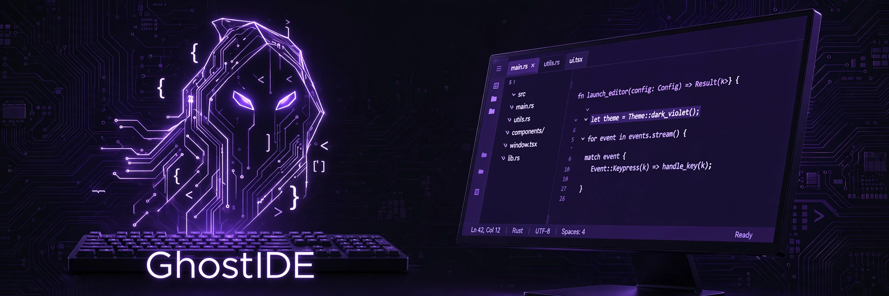

# GhostIDE 👻
[](LICENSE) [](https://github.com/littlestjames82-sys/ghost-ide/actions/workflows/build-desktop.yml)

A fully offline AI code editor from Ghost Developer Studio.
The editor, the chat, the agent, and the autocomplete all
run locally: the AI is a Qwen2.5-Coder model served by
llama.cpp on the desktop, or running on-device in the
Android app (see the
[`ghostide-android`](https://github.com/littlestjames82-sys/ghostide-android)
repo). No cloud, no API key, no account.

**Your code never leaves the device. The AI lives here.**

**▶ Watch it run: [the 55-second demo](docs/media/ghostide-demo.mp4)** —
the real app, driven live: editor diagnostics on a real syntax
error, the git client, a live test run, the ecosystem catalog,
and the agent's approval controls. Narrated by Ryan.

This repo is the shared heart of both editions: the
frontend bundle built from `web/src` ships in the desktop
app *and* inside the Android APK, and `server.py` is the
reference implementation of the API the Android app's
Java server mirrors. One behavior pack (`BEHAVIOR.md`)
drives both, so the editions cannot silently drift.

## The model store (Qwen2.5-Coder-Instruct, Q4_K_M GGUF)

| Model | Download | RAM while running | Notes |
|---|---|---|---|
| 0.5B Sprinter | 380 MB | ~0.7 GB | phone store; fastest, rough edges |
| 1.5B Balanced | 0.94 GB | ~1.5 GB | phone default |
| 3B Smarter | 1.93 GB | ~2.6 GB | phone store; 6 GB+ phones |
| 7B Max | 4.68 GB | ~5.5 GB | desktop default + phone store (8 GB+ phones) |

Every download is exact-size and SHA-256 verified before
use, and resumable. On the desktop, download the 7B in
Settings ("Download 7B model"), switch models any time
with a GGUF path in Settings or `GHOST_IDE_MODEL`, or use
the in-app model switcher.

## Run it

From source (needs Python 3.11+ and a llama.cpp build):

```bash
./start.sh                 # http://127.0.0.1:5173
```

Then click **Start model** in the top bar (first load
takes about a minute).

As a packaged app (Roadmap G18): `packaging/` builds
installable packages for Linux, macOS, and Windows
(PyInstaller + bundled llama.cpp, one-command install,
workspace seeded in ~/GhostIDE). A manual GitHub Actions
workflow (`.github/workflows/build-desktop.yml`) builds
all three. The package contains no model; the 7B is an
optional in-app download.

Pair mode: another device can join this workspace with a
pairing token (tokens expire in 12 hours; viewers are
read-only). Binding the server beyond loopback
(`GHOST_IDE_HOST=0.0.0.0`) is for trusted networks: the
pairing gate protects the API, but the static shell is
served ungated by design.

## What's inside

- **Editor**: CodeMirror 6 (JS/TS, Python, HTML, CSS,
  JSON, Markdown), tabs, split view, multi-cursor,
  **live syntax diagnostics** in the gutter as you type,
  **code folding**, find & replace with regex, ignore-case
  and dry-run previews, command palette, quick open,
  local history with restore, autosave draft recovery,
  and session restore down to cursor positions.
- **Ghost Chat**: streaming chat with context modes:
  current file, smart slice (the file's dependency web,
  reason-tagged and budget-packed), or project slice
  (signatures or full) with a token meter.
- **Agent mode**: Ghost plans and executes multi-file
  changes one action at a time; writes stage for your
  review with diffs, and nothing lands until you
  approve it. The agent cannot declare DONE over broken
  staged code (staged files are syntax-checked first,
  with bounded self-repair rounds you control), it can
  pause mid-run, queue follow-ups, keep a scratchpad,
  dispatch read-only EXPLORE sub-runs, and works under
  step budgets — with a full replayable trail per run.
- **Git**: a complete daily client — status with
  ahead/behind, stage, commit, branches, stash, tags,
  amend, worktrees, blame, log with a commit viewer,
  remotes — behind server-side input pins (names
  regex-checked, refs rebuilt, hashes hex-pinned). The
  agent's git surface is read-only by construction.
- **Tests & verify**: discover and run Python + Node
  tests — whole suite, one file, or a single test by
  name — re-run only failures, and run the verify
  pipeline with evidence levels (Executed / Claimed /
  Gaps, never a silent pass).
- **The ecosystem**: 29 bundled Ghost tools (GhostSlice,
  GhostMCP, GhostApprove, GhostIndex, GhostReview, and
  24 more) execute for real against the workspace; the
  full table lives in the Android repo's README, and
  the bundle only builds when every tool's own tests
  pass (2,871 at generation e13).
- **Platform**: project templates, a sandboxed plugin
  system (`PLUGINS.md`), pair mode with conflict-safe
  sync, voice coding, and optional encrypted backups
  (`PRIVACY.md` explains the data story, which is
  short: nothing is collected).
- **Updates**: Settings can check for updates against
  `VERSION.json` in this repo. It only ever reports; it
  never downloads or installs by itself.

## How it is proven

GhostIDE is developed in audited **20x20 campaign
cycles** (`CAMPAIGN_20x20.md`): twenty improvements,
then twenty adversarial audits against a standing
checklist, released in batches of five. The machinery:

- **Harness suite** — `node tools/harness/run-all.mjs`
  (137 files at v3.10.0) pins routes, rails, censuses
  and regressions in the shipped sources.
- **DOM-stub bundle gate** — the built web bundle is
  executed headlessly and must get past startup
  construction; a stillborn bundle cannot ship.
- **Live probes** — `tools/probes/` drives real
  servers against fixture workspaces, including a
  canary sweep: a planted API key must appear in zero
  route responses.
- **Ecosystem bundle gate** — `tools/eco_bundle_gate.py`
  runs every bundled tool's own test suite before the
  Android build may include it.

Proof comes in layers (compile + pins, desktop-live,
on-device) and the record says which layer proved
what — see `docs/TESTING.md` in the Android repo.

## Layout

- `server.py` — the desktop backend (Python stdlib only)
- `debug_bridge.py` — the debugger bridge (bdb over stdio)
- `web/` — the frontend (CodeMirror 6, built with esbuild)
- `tools/` — the harness suite, probes, and bundle gates
- `playground/` — the seed workspace
- `packaging/` — desktop app packaging (G18)
- `PLAN.md`, `ROADMAP_20.md`, `ROADMAP_ECO.md`,
  `CAMPAIGN_20x20.md` — plans, roadmaps, and the
  campaign record
- `RUN-ON-PHONE.md` — using the desktop build from a
  phone browser on your LAN

MIT licensed. Built by Ghost Developer Studio, Oakdale,
Tennessee.

---
<!-- ghost-studio-footer -->
## More from Ghost Developer Studio

Ghost Developer Studio builds developer tools, AI-agent safety software, and practical apps, and sells by showing working software, not slide decks.

- [Roadmap board](https://github.com/littlestjames82-sys/ghost-roadmaps): where every studio product stands
- [Agent Seatbelt](https://github.com/littlestjames82-sys/agent-seatbelt): deterministic guardrails for AI coding agents
- [Ghost Hands](https://github.com/littlestjames82-sys/ghost-hands): governed, recorded, replayable agent hands
- [GhostSlice](https://github.com/littlestjames82-sys/ghostslice): agent context and prompt optimizer
- [GhostIDE](https://github.com/littlestjames82-sys/ghostide-android): fully offline AI code editor for Android
- [All studio projects](https://github.com/littlestjames82-sys?tab=repositories)
